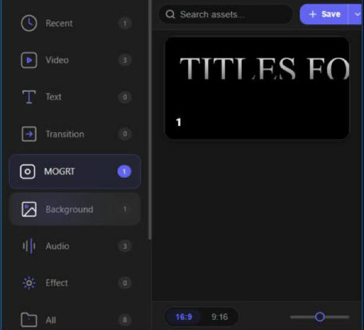
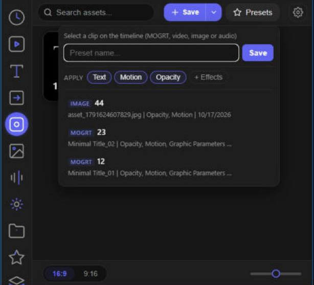
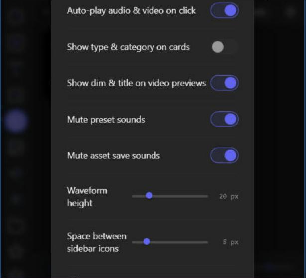
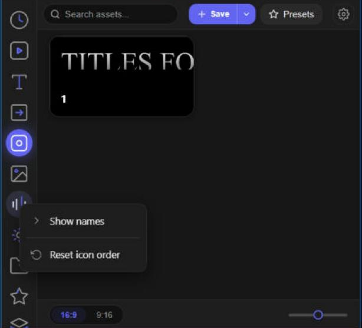
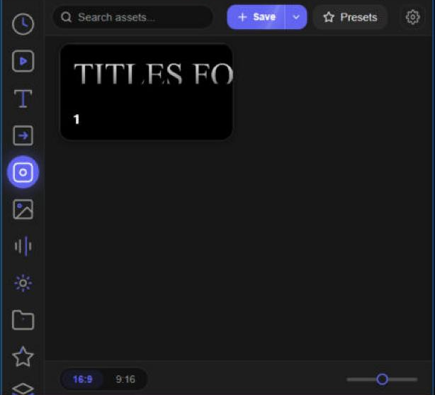

# VibeTools

A reusable **asset library** for Adobe Premiere Pro 2024+, packaged as a CEP
panel. Save timeline selections (or import external media) as reusable assets,
then drag them back onto the timeline with correct track targeting — every
effect, keyframe, transition and nested structure preserved.

> Windows only. Targets Premiere Pro 2024+ (`PPRO 24.0`+); developed and tested
> on Premiere Pro 2026 (v26.2.2).

VibeTools is free and open source (MIT). If it saves you time, you can
[buy me a coffee on Ko-fi](https://ko-fi.com/uncleluki) ☕ — entirely optional.

> 🎛️ **Fully vibe-coded** — built hand-in-hand with AI. It does real work in
> real timelines; it just isn't over-engineered. There are no automated tests,
> so verify any changes yourself. MIT, no gatekeeping — fork it, break it,
> improve it. Issues and PRs welcome.

<table>
  <tr>
    <td width="33%"></td>
    <td width="33%"></td>
    <td width="33%"></td>
  </tr>
  <tr>
    <td align="center"><sub>Browse by category</sub></td>
    <td align="center"><sub>Asset library</sub></td>
    <td align="center"><sub>Audio preview (pitch / reverse)</sub></td>
  </tr>
</table>

---

## About this fork

This fork builds on [UncleLuki's VibeTools](https://github.com/uncleeai/VibeTools)
(MIT) with fixes and features made while using it daily in Premiere Pro 2026.
Everything from the original keeps working; the changes are listed below and in
[CHANGELOG-FORK.md](CHANGELOG-FORK.md).

<table>
  <tr>
    <td width="33%"></td>
    <td width="33%"></td>
    <td width="33%"></td>
  </tr>
  <tr>
    <td align="center"><sub>Reorderable categories</sub></td>
    <td align="center"><sub>Per-clip presets (MOGRT, video, image, audio)</sub></td>
    <td align="center"><sub>Settings</sub></td>
  </tr>
  <tr>
    <td width="33%"></td>
    <td width="33%"></td>
    <td width="33%"></td>
  </tr>
  <tr>
    <td align="center"><sub>Sidebar menu: icons only / reset order</sub></td>
    <td align="center"><sub>Saved MOGRT asset</sub></td>
    <td></td>
  </tr>
</table>

### MOGRT assets (e.g. titles from AtomX)

- **Native MOGRT save and insert.** A saved MOGRT is stored as its template plus
  every parameter value. Inserting it places the template directly and applies
  the values - no clipboard, no helper `VT_Asset` sequence opening and closing.
- **One history step.** Dragging a saved MOGRT leaves a single *Overwrite* in the
  History panel; the placeholder drop is taken back with undo, step by step and
  verified, so a user's own edit is never touched.
- **Playhead stays put** on double-click and on drag.

### Presets

- **Per-clip presets**, Premiere Composer style: a preset belongs to the clip it
  was saved from - a MOGRT template, or a video, image or audio file - and is
  only shown for that clip.
- **Video presets** read the video part of a linked clip (Motion, Opacity,
  effects) and are applied to the video part only.
- **Apply options**: keep the clip's own text (apply only font/size/colour),
  skip Motion or Opacity, add effects the clip is missing.

### Timeline inserts and undo

- **Ctrl+Z undoes an insert in one step and it stays undone** (a native drag used
  to come back after the first Ctrl+Z).
- **No helper actions in the History panel** - no greyed "Create VT_undo..." /
  "Rename item..." lines, no Create bin / Move / Delete bin chains.
- **Media goes to the project root** like Premiere's own drag & drop (no
  `VibeAssets` bin), and a file already in the project is reused, not imported again.
- **Double-click and drag size video the same way** - your Premiere *Default
  Media Scaling* decides.

### Library

- **Delete without a confirmation**, including files still held open by a
  preview (they are released first; anything still locked is removed on the
  next start, together with leftovers of failed deletes from older versions).
- **Reorder the category icons** by dragging them; the group separator can be
  dragged too. Right-click the sidebar for *Icons only / Show names* and
  *Reset icon order*.
- **Reopens on the last used category.**
- **Space between sidebar icons** is adjustable in Settings.

### Reliability

- Fixed inserts that pasted the previous media instead of the chosen asset.
- Fixed a host-script load failure (`EvalScript error`) caused by an ES3
  reserved word.
- Debug log rotation, FFmpeg called without a shell, cache-busted panel files so
  Premiere never runs a stale copy after an update.

---

## What it does

- **Save** a timeline selection as a self-contained asset — it captures a real
  `.prproj` fragment plus an auto-generated preview, so fidelity is exact (not a
  flattened render).
- **Import** external media files as assets.
- **Drag & drop** assets back onto the timeline, dropped on the track you target.
- **Audio assets**: live pitch/reverse preview, rendered with FFmpeg.
- **MOGRT** support.

## Requirements

- Windows
- Adobe Premiere Pro 2024 or newer (24.0+) — tested on 2026 (v26.2.2)
- An `ffmpeg.exe` at `vendor/ffmpeg/ffmpeg.exe` (a build is bundled — see
  [FFmpeg](#ffmpeg) below)

## Install (prebuilt)

The repo ships with the prebuilt native binaries, so you don't need Visual
Studio just to run the panel.

1. **Enable unsigned CEP extensions.** VibeTools is not Adobe-signed, so set
   Premiere to allow debug extensions. In the registry under
   `HKEY_CURRENT_USER\Software\Adobe\CSXS.11`, add/set a **String** value
   `PlayerDebugMode = 1`. (The number after `CSXS` matches your CEP runtime; on
   Premiere 2024 it's `CSXS.11`. Restart Premiere afterwards.)

2. **Install the panel.** Copy this whole folder into the CEP extensions
   directory so it lands as:
   ```
   C:\Program Files (x86)\Common Files\Adobe\CEP\extensions\VibeTools\
   ```

3. **Install the importer plugin.** Copy `support_files\VT_Importer.prm` to:
   ```
   C:\Program Files\Adobe\Common\Plug-ins\7.0\MediaCore\VibeTools\
   ```
   (create the `VibeTools` folder). This registers the `.vtbk` extension used
   for precise drag-and-drop track targeting.

4. **Launch.** Start Premiere Pro and open the panel from
   **Window → Extensions → VibeTools**.

### FFmpeg

Audio pitch/reverse previews are rendered by FFmpeg, invoked as a separate
process. A prebuilt `ffmpeg.exe` is bundled at `vendor/ffmpeg/ffmpeg.exe`. If
you remove it or want a different build, drop any `ffmpeg.exe` at that path, or
fetch one via `npm i ffmpeg-static`. See [`vendor/ffmpeg/LICENSE.txt`](vendor/ffmpeg/LICENSE.txt).

## Build from source (optional)

Only needed if you change the native code. Requires Visual Studio 2022 (C++
desktop workload), CMake, x64. Run each batch script **from its own directory**.

| Component | How | Output |
|-----------|-----|--------|
| `VT_ExternalObject.dll` | `cpp\build.bat` | copied to `support_files\` |
| `VT_Importer.prm` | `importer\build.bat` | install to MediaCore (see above) |
| `VT_ControlSurface.acsrf` | build `native\VT_ControlSurface\VT_ControlSurface.sln` | — |

The importer and control surface build against the **Adobe Premiere Pro C++
SDK**, which is proprietary and **not** included here — download it from Adobe
and place it where the build scripts expect (see `CLAUDE.md`).

The web layer (HTML/CSS/JS) is loaded directly by Premiere — no build step.

## Architecture

VibeTools spans four layers across three runtimes (CEP panel → ExtendScript host
→ native DLL → native plugins). The full architecture, data flow, and the
save/apply workflows are documented in [`CLAUDE.md`](CLAUDE.md).

## Contributing

This is a hobby project that isn't actively polished, but issues and PRs are
welcome. There's no automated test suite — changes are verified manually in
Premiere.

## License

[MIT](LICENSE) © 2026 UncleLuki.

Bundled third-party components keep their own licenses — see [CREDITS.md](CREDITS.md).
Notably, the bundled FFmpeg binary is GPLv3; VibeTools calls it as a separate
process and is not a derivative work of it.

Adobe, Premiere Pro, and related marks are trademarks of Adobe Inc. This is an
independent project, not affiliated with or endorsed by Adobe.
